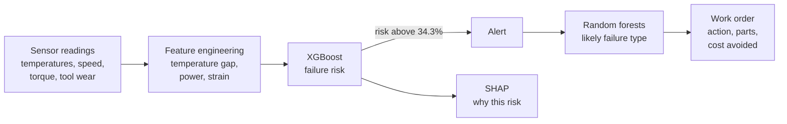

# Machine Health Monitor

**Predict machine failures from sensor data, diagnose the likely cause, and generate maintenance work orders before the breakdown happens.**

   

Hackathon project for **Future Tech, FT-03: Predictive Maintenance for Industry**.

## The problem

An unplanned breakdown stops a production line and costs far more than a planned repair. Most plants still rely on fixed alarm limits ("ring the bell when one sensor passes a number"). That approach either misses failures or rings so often that nobody trusts it.

## What it does

| Tab | What you get |
|---|---|
| **Fleet overview** | Ten machines on one shop floor. Faults creep in on some of them; the system raises an alert, names the likely cause and writes a **work order** (priority, action, parts to check, money saved). Work orders download as CSV. |
| **Check a machine** | Enter six sensor readings. Get a failure risk gauge, the likely failure type, a plain-English reading of the sensors, and a SHAP chart showing what pushes the risk up or down. |
| **Watch it degrade** | One machine wears out step by step. The alert fires before the end of the run. |
| **Why not a simple alarm?** | Set fixed sensor limits yourself, or let the app find the cheapest ones, and compare them with the model on the same 10,000 readings. |
| **What it saves** | Editable cost assumptions turn detection results into rupees saved per year. |
| **Score a file** | Upload a CSV of readings and get a risk score for every row. |

## How it works



- **Data:** [AI4I 2020 Predictive Maintenance Dataset](https://archive.ics.uci.edu/dataset/601/ai4i+2020+predictive+maintenance+dataset) (UCI). 10,000 readings, 339 failures (3.4%). It is a synthetic benchmark, not data from a real factory.
- **Features:** the five raw sensors plus three engineered ones that mirror how failures arise: temperature gap (heat), power (torque x speed) and strain (tool wear x torque).
- **Failure model:** XGBoost with class weighting for the rare failures.
- **Alert line:** 34.3%, chosen so that at least 85% of failures are caught. Missing a failure costs much more than a false inspection.
- **Diagnosis:** one random forest per failure type (tool wear, heat dissipation, power, overstrain). The app shows each type as a share of the four, so the diagnosis confidence is comparable.
- **Accuracy is not the metric.** Failures are 3.4% of the data, so a model that never raises an alert is already 96.6% "accurate". Recall, precision and PR-AUC are reported instead.

## Results

Cross-validated results, scored on readings the model had not seen:

| Metric | Value |
|---|---|
| Recall (failures caught) | **84.7%** |
| Precision (alerts that were real) | **73.2%** |
| PR-AUC | 0.873 |

Hold-out check (2,000 readings, 68 failures) at the alert line: 58 failures caught, 10 missed, 21 false alarms.

### Against a fixed-limit alarm

The fixed alarm uses three single-sensor limits (tool wear, torque, process temperature). The limits below are the cheapest combination the app could find **on the same data it is scored on**, which is the most generous test a fixed alarm can get.

| | Best fixed limits (205 min, 48 Nm, 314 K) | This model |
|---|---|---|
| Failures caught | 280 of 339 (83%) | 287 of 339 (85%) |
| Failures missed | 59 | 52 |
| **False alarms** | **2,288** | **105** |
| Alerts that were real | 11% | 73% |
| Estimated cost* | ₹3.44 crore | ₹2.24 crore |

\*Example costs: unplanned failure ₹2,00,000, planned repair ₹40,000, false-alarm inspection ₹5,000. With no monitoring at all the same 339 failures would cost ₹6.78 crore. The model's counts are rebuilt from its cross-validated recall and precision.

The two approaches catch a similar share of failures. The difference is that the fixed alarm gets there by raising about 22 times more false alarms.

### Fleet demo (example run)

Ten simulated machines, 90 operating hours. Five stay healthy; five develop a fault and are flagged before the run ends:

| Machine | Fault | Alert raised | Warning time | Diagnosis |
|---|---|---|---|---|
| M-06 Drill B | Power overload | hour 48 | 42 h | Power |
| M-04 Lathe B | Cooling loss | hour 67 | 23 h | Heat dissipation |
| M-07 Press A | Worn tool, rising load | hour 69 | 21 h | Overstrain |
| M-02 Milling B | Worn tool, rising load | hour 71 | 19 h | Overstrain |
| M-09 Grinder A | Cooling loss | hour 71 | 19 h | Heat dissipation |

## Run it locally

Tested with Python 3.11. Download or clone this repository, open a terminal in the project folder, then:

```bash
python -m venv .venv

# Windows (PowerShell)
.venv\Scripts\Activate.ps1
# macOS / Linux
source .venv/bin/activate

pip install -r requirements.txt
python app.py
```

Open http://127.0.0.1:7860 in your browser.

`scikit-learn` is pinned to 1.6.1 because the saved random forests were trained with that version. The XGBoost model is stored as JSON, so it loads across XGBoost versions. SHAP is optional: without it the "Check a machine" tab falls back to global feature importance.

The models were trained in Google Colab (see "How it works"); the trained files are included, so no training step is needed to run the app.

## Project structure

```
.
├── app.py              Gradio app (all tabs)
├── pm_xgb.json         XGBoost failure classifier
├── pm_meta.joblib      failure-type random forests, feature list, alert threshold
├── pm_clean.csv        AI4I 2020, cleaned, with the engineered features
└── requirements.txt
```

## Limitations

- **The data is synthetic.** AI4I 2020 is a benchmark. Results here say nothing certain about a real plant; the model would need to be retrained and validated on plant data.
- **The fleet is simulated.** The ten machines stream generated sensor readings; the risk scores and diagnoses come from the trained model. Connecting real sensors (for example over MQTT or OPC-UA) is the next step.
- **Risk rises sharply, not gradually.** The failures in this dataset are rule-based, so the model learns thresholds. The alert fires before the end of a run, but the risk curve is a steep climb rather than a slow drift.
- **The alert line was tuned on a hold-out split**, and the cross-validation numbers reuse it, so they may be slightly optimistic.
- **Cost figures are examples.** Replace them with a plant's real numbers in the "What it saves" tab.

## Possible next steps

- Train on real plant data, including time-series history rather than single readings
- Stream live sensor data and keep per-machine history
- Predict remaining useful life, not just the chance of failure
- Learn from maintenance feedback to tune the alert line per machine
